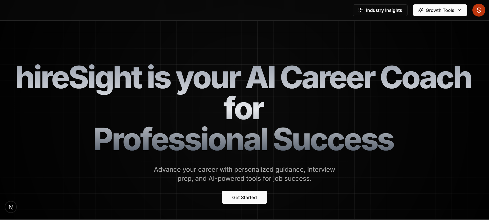
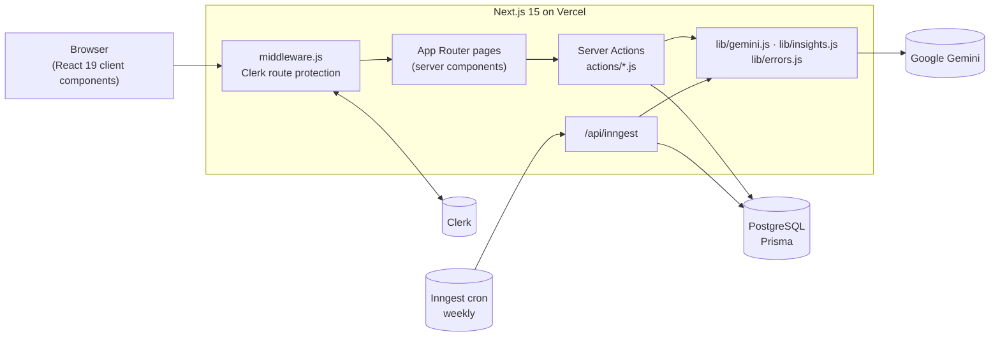
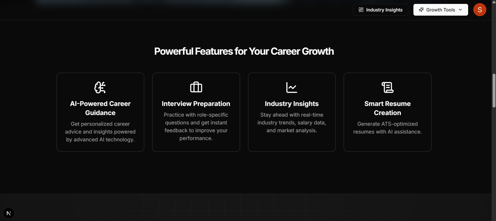
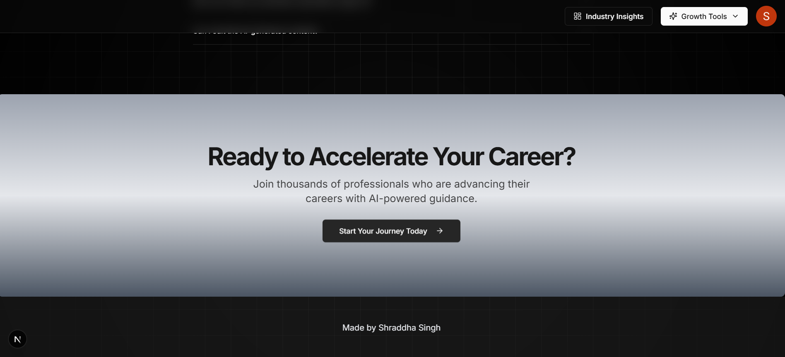

# Hiresight – AI Career Coach

Hiresight is a full-stack web app that helps students and early-career
engineers get job-ready. After a short onboarding (industry, experience,
skills) it gives you an AI-generated **industry dashboard**, a **resume
builder** with five exportable templates, **AI cover letters**, and **mock
interview quizzes** with per-question explanations and progress tracking.

**Live:** https://hiresight-three.vercel.app



---

## Features

| Area | What it does |
|---|---|
| **Onboarding** | Pick an industry + specialization, years of experience, skills and bio. Validated with Zod on the client and again on the server. |
| **Industry Insights dashboard** | Gemini generates salary ranges by role, growth rate, demand level, market outlook, key trends and recommended skills for your industry. Cached per industry in PostgreSQL and refreshed weekly by an Inngest cron job. |
| **Resume builder** | Form-driven editor (contact, summary, skills, experience, education, projects) with live preview, a Markdown mode, five templates (Classic FAANG, Modern Professional, Minimal ATS, Premium Tech, Student/Fresher), "Improve with AI" for any entry, and pixel-matched A4 PDF export. One resume per user is saved to the database. |
| **AI cover letters** | Paste a job description; Gemini writes a tailored, ATS-friendly letter grounded only in your profile and saved resume (no invented experience). Letters are listed, editable with autosave, regenerable, exportable to PDF/Word, and deletable. |
| **Mock interviews** | 10 industry-specific multiple-choice questions per quiz, explanations per question, an AI improvement tip for wrong answers, and a history page with average/latest score and a performance chart. |
| **Auth & theming** | Clerk authentication (sign-in / sign-up pages, protected routes via middleware), light/dark theme. |

## Tech stack

- **Framework:** Next.js 15 (App Router, React 19, Server Actions), JavaScript
- **UI:** Tailwind CSS, shadcn/ui (Radix primitives), lucide-react, Recharts
- **Auth:** Clerk
- **Database:** PostgreSQL via Prisma ORM (migrations in `prisma/migrations`)
- **AI:** Google Gemini (`@google/generative-ai`) with retry + model fallback (`lib/gemini.js`)
- **Background jobs:** Inngest (weekly industry-insight refresh)
- **Validation:** Zod + react-hook-form
- **Export:** html2pdf.js (client-side PDF)
- **Hosting:** Vercel

## Architecture



**Request flow:** every `/dashboard`, `/resume`, `/interview`, `/ai-cover-letter`
and `/onboarding` request passes through Clerk middleware; unauthenticated
users are redirected to sign-in. Server components call server actions, which
resolve the Clerk user to a database row, validate input, call Gemini through
the shared client, and persist results with Prisma. Errors are mapped to short,
safe messages in `lib/errors.js` and rendered by the route error boundary
(`app/(main)/error.jsx`) or toasts.

**Data model** (`prisma/schema.prisma`): `User` 1–1 `Resume`, 1–N `CoverLetter`,
1–N `Assessment`; `User` N–1 `IndustryInsight` (keyed by the combined
industry string, e.g. `tech-software-development`).

## Screenshots

| Features | Call to action |
|---|---|
|  |  |

## Getting started

### Prerequisites

- Node.js 20+ and npm
- A PostgreSQL database (Neon, Supabase, or local)
- A [Clerk](https://dashboard.clerk.com) application
- A [Google Gemini API key](https://aistudio.google.com/app/apikey)

### Install and run

```bash
git clone https://github.com/Shrasingh/hiresight.git
cd hiresight
npm install                # also runs `prisma generate`
cp .env.example .env.local # then fill in the values below
npx prisma migrate deploy  # apply the committed migrations to your database
npm run dev                # http://localhost:3000
```

Optional, for the weekly insight refresh locally:

```bash
npx inngest-cli@latest dev   # then open http://localhost:8288
```

### Environment variables

All variables are documented with placeholders in [`.env.example`](./.env.example).

| Variable | Required | Purpose |
|---|---|---|
| `DATABASE_URL` | yes | PostgreSQL connection string used by Prisma |
| `NEXT_PUBLIC_CLERK_PUBLISHABLE_KEY`, `CLERK_SECRET_KEY` | yes | Clerk auth |
| `NEXT_PUBLIC_CLERK_SIGN_IN_URL`, `NEXT_PUBLIC_CLERK_SIGN_UP_URL` | yes | `/sign-in`, `/sign-up` |
| `NEXT_PUBLIC_CLERK_SIGN_IN_FALLBACK_REDIRECT_URL`, `NEXT_PUBLIC_CLERK_SIGN_UP_FALLBACK_REDIRECT_URL` | yes | `/onboarding` |
| `GEMINI_API_KEY` | yes | Google Gemini |
| `GEMINI_MODEL`, `GEMINI_FALLBACK_MODELS` | no | Override the default model / fallback chain |
| `INNGEST_EVENT_KEY`, `INNGEST_SIGNING_KEY` | production only | Inngest cloud |

### Scripts

| Command | What it does |
|---|---|
| `npm run dev` | Development server (Turbopack) |
| `npm run lint` | ESLint 9 flat config (`next/core-web-vitals`) |
| `npm run build` | Production build (`next build`) |
| `npm start` | Serve the production build |
| `npx prisma migrate dev --name <change>` | Create a new migration from schema changes |
| `npx prisma migrate deploy` | Apply committed migrations (staging / production) |
| `npx prisma studio` | Browse the database |

There is no automated test suite yet; CI runs lint and a production build
(see below).

## Development workflow & deployment

- Branches: `develop` (integration) → `staging` (QA / release candidate) →
  `master` (production). The full promotion process, hotfix rule and
  migration steps are in [CONTRIBUTING.md](./CONTRIBUTING.md).
- CI: [`.github/workflows/ci.yml`](./.github/workflows/ci.yml) runs
  `npm run lint` and `npm run build` on every push and pull request to those
  three branches.
- Deployment: Vercel's Git integration builds a preview for every branch and
  deploys `master` to production at https://hiresight-three.vercel.app. Set the
  environment variables above in the Vercel project and run
  `npx prisma migrate deploy` against the production database when a migration
  is added.

## Project structure

```
app/
  (auth)/           sign-in, sign-up (Clerk)
  (main)/           protected pages: dashboard, onboarding, resume, interview, ai-cover-letter
  api/inngest/      Inngest webhook
  lib/schema.js     Zod schemas (client + server)
actions/            server actions (user, dashboard, resume, interview, cover-letter)
lib/                prisma client, gemini client, insights generator, error mapping, inngest
components/         header, hero, theme toggle, shadcn/ui primitives
data/               industries list and landing-page copy
prisma/             schema and migrations
```

## Known limitations

- AI output quality depends on the Gemini model; responses are schema-validated
  and retried, but can still be refused by safety filters.
- The dashboard's salary figures are AI estimates, not sourced market data.
- Landing-page statistics and testimonials are illustrative placeholder content.
- No automated tests yet; quality gates are lint + production build in CI.
- Local `next build` requires the environment variables above to be set (CI
  uses placeholders).

## Acknowledgements

The initial scaffold followed the open "AI Career Coach" tutorial by Piyush
Agarwal; the resume templates, cover-letter editor, Gemini reliability layer,
validation, theming and workflow were built on top of it.

## Author

Shraddha Singh · [GitHub](https://github.com/Shrasingh)
